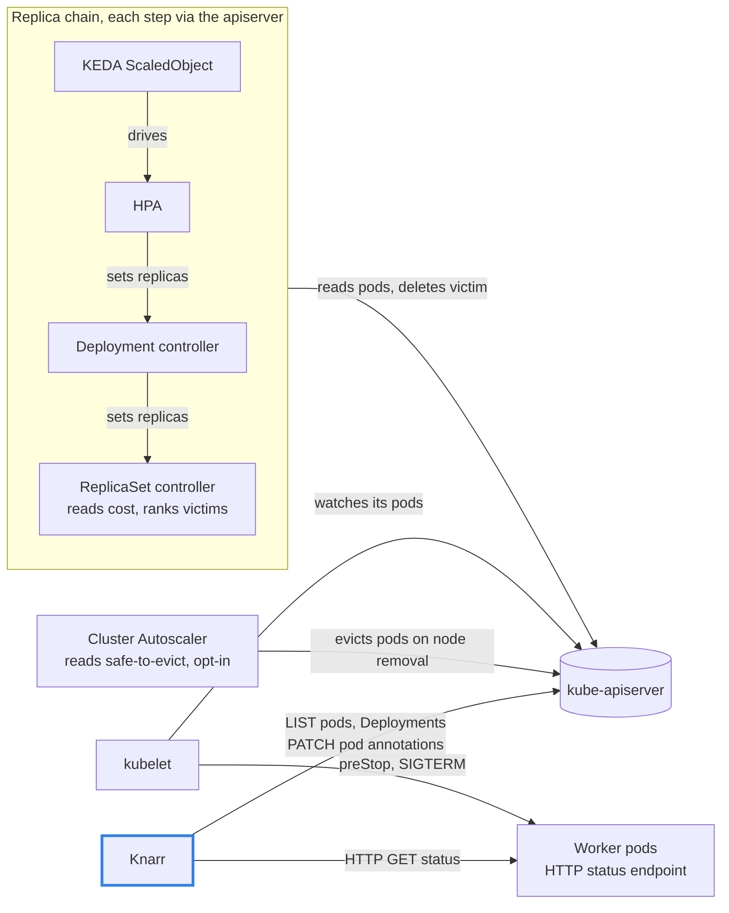
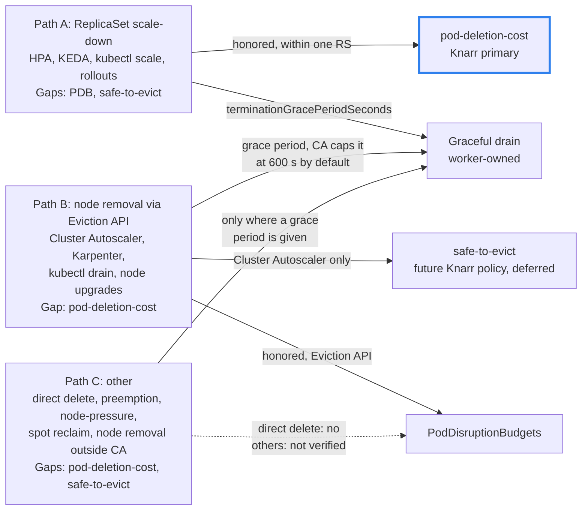
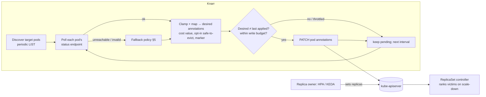
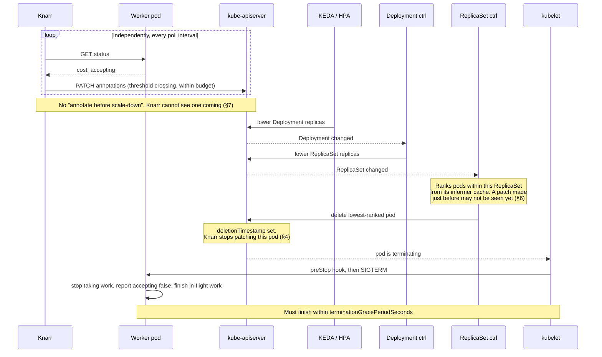
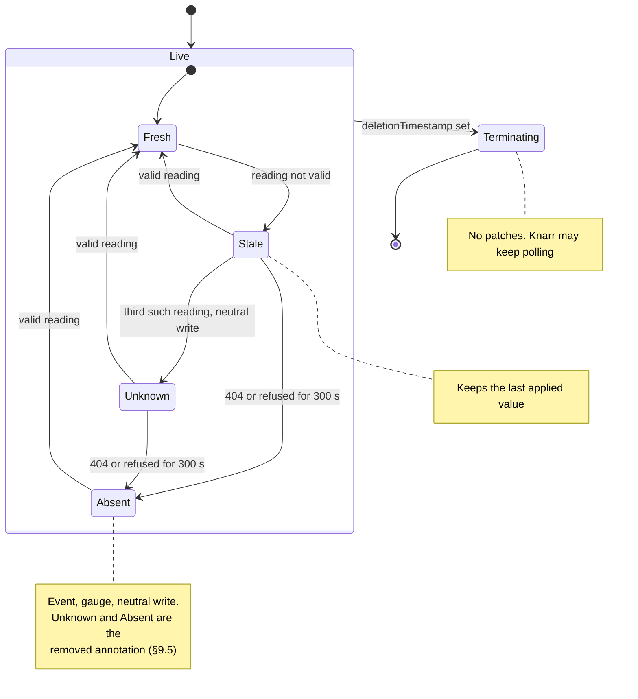
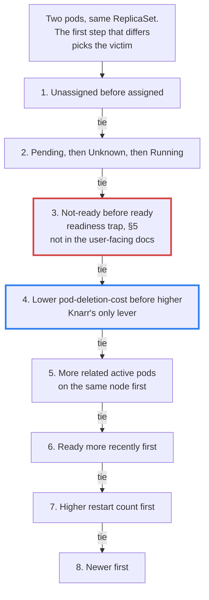
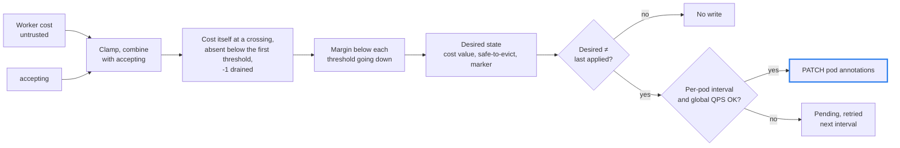
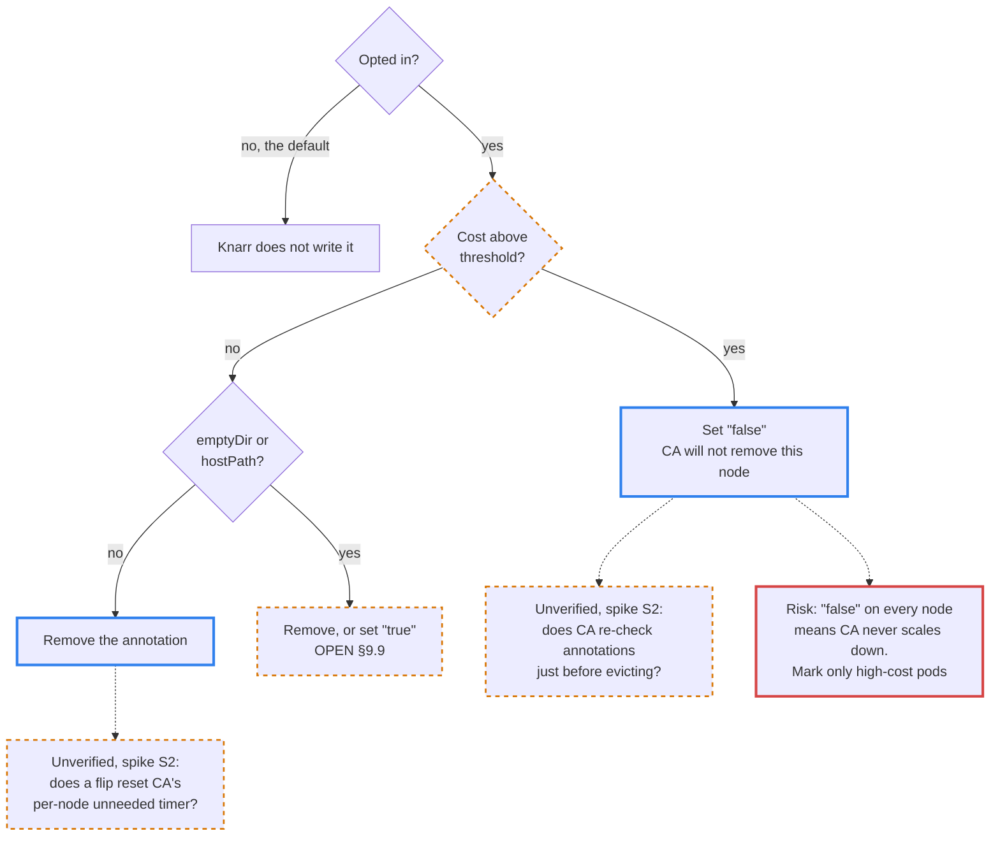
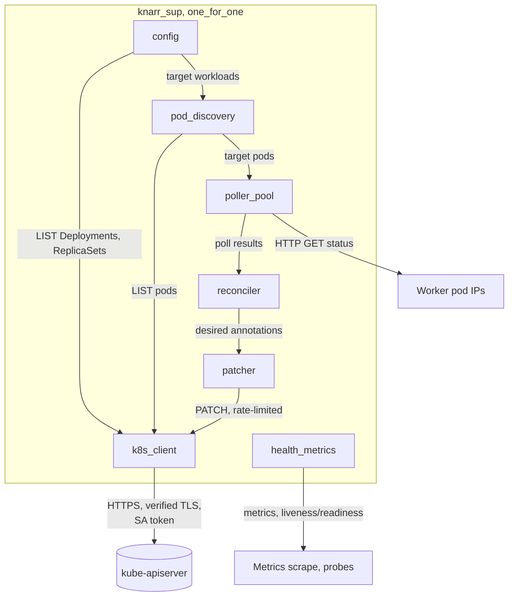
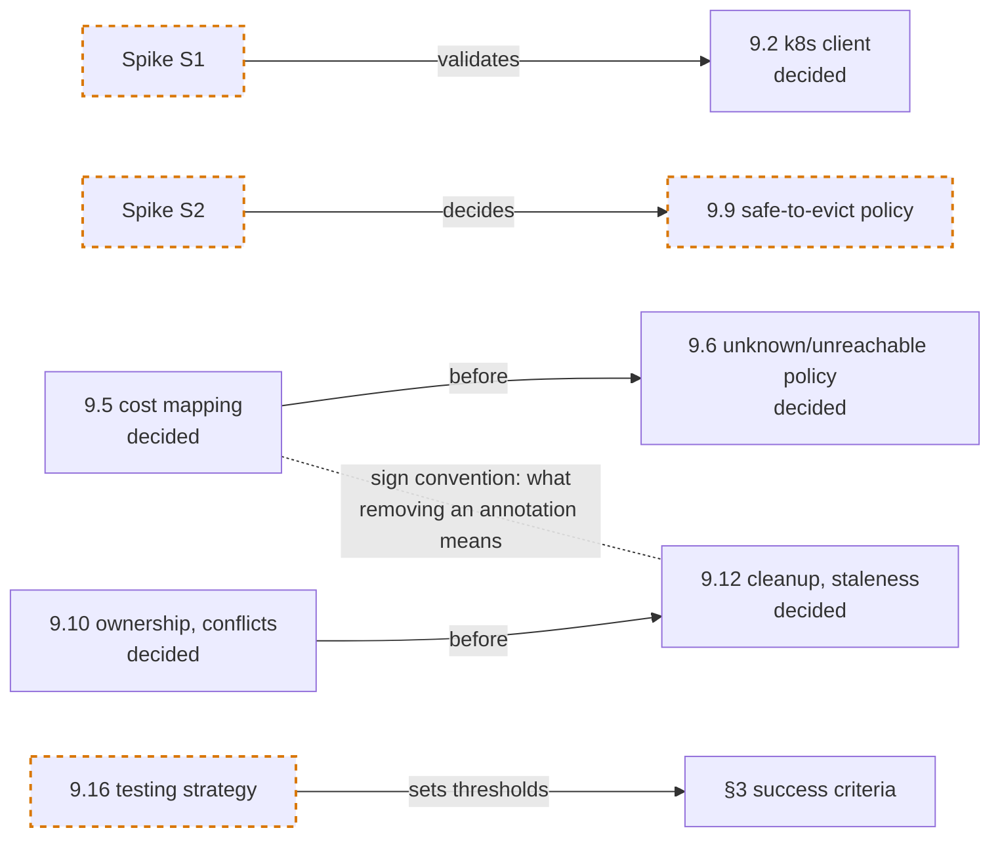

# Knarr: Project Overview

> **Status:** Draft, scoped to the MVP. This document sets a high-level direction for later work and for drafting tickets. It is not a specification. Anything marked **OPEN** has not been decided and will be settled in a ticket. **Recommended** means a proposed default, not a decision. Post-MVP options, alternatives and research notes live in [DEFERRED.md](DEFERRED.md).
>
> **Scope update (2026-10-15):** safe-to-evict is deferred outside the MVP. Its retained policy discussion and diagrams describe future work, not an available protection. See [the deferral record](DEFERRED.md#safe-to-evict-policy-deferred-on-2026-10-15) and [current configuration guidance](reference/configuration.md#deferred-safe-to-evict-feature).
>
> **Diagrams** only restate what the text says. A thick blue border marks what Knarr controls, a dashed orange border marks OPEN or unverified items, and a red border marks a risk or trap. A visual explainer for the densest parts (victim ranking, the cost value and sign convention, kill paths) is in [overview-explainer.html](overview-explainer.html). GitHub shows that file as source, so open it locally in a browser.

## 1. Summary

Knarr is a Kubernetes controller written in [Gleam](https://gleam.run/) that runs on the BEAM (Erlang target). It is for autoscaled worker fleets that run a mix of very quick tasks and long-running jobs. Knarr polls an HTTP status endpoint on each worker pod and uses the result to set `controller.kubernetes.io/pod-deletion-cost` on that pod. When a Deployment scales down, Kubernetes then prefers to remove idle or cheap pods over busy ones, as long as the pods are otherwise equal (scheduled, Running and Ready; see §6). This is a **best-effort bias**, not a guarantee. Knarr is meant to be generic: any worker that implements a small HTTP contract can take part.



### MVP at a glance

| Item | Status | Where |
| --- | --- | --- |
| Target platform: GKE Standard; MVP bar is running a real production workload | Decided | §6 |
| Runtime: Gleam on the BEAM (Erlang target) | Decided | §8 |
| Workload kind: Deployments only | Decided | §3 |
| Primary mechanism: `pod-deletion-cost` on live Pod objects | Decided | §6 |
| Guarantee level: best-effort bias only; graceful drain is the safety net | Decided | §3, §5 |
| Worker contract: pull (Knarr polls each pod over HTTP) | Decided | §5 |
| v1 payload: worker-supplied cost and accepting/drain state, nothing else | Decided | §5 |
| `safe-to-evict`: outside the MVP; policy and implementation deferred | Deferred 2026-10-15 | [DEFERRED.md](DEFERRED.md#safe-to-evict-policy-deferred-on-2026-10-15), §9.9 |
| Karpenter: not a target | Decided | §3 |
| Prerequisite: Kubernetes 1.22 or later with the `PodDeletionCost` gate enabled (the default) | Fact | §6 |
| Scaling ownership: option (a), annotations only; (b) is a planned quick follow | Decided | §7, §9.3 |
| Configuration: labels and annotations on Deployments (a controller, not an operator) | Decided | §9.1 |
| k8s client: option (A), pure Gleam plus Erlang FFI | Decided | §8, §9.2 |
| Pod discovery: periodic LIST | Decided | §4 |
| HA model: single replica, no leader election | Decided | §8, §9.19 |
| Install scope: one namespace (Role) | Decided | §9.18 |
| Packaging: a Helm chart on GHCR with the image pinned by digest, the only supported install once 0015's ticket 06 retires the kustomize overlay; the overlay stays documented until then | Decided | §9.15, [Decision 0015](decisions/0015-helm-chart.md) |

## 2. Problem

### Mixed workloads and naive scale-down

Worker fleets often handle two kinds of work in the same pods:

- **Quick tasks** (milliseconds to seconds). Losing one costs little.
- **Long-running jobs** (minutes to hours). Killing one partway through wastes the work and may mean a retry or manual cleanup.

Autoscalers such as HPA and KEDA (ScaledObject) decide **how many** replicas to run. They do not decide **which** pod is removed. The ReplicaSet controller picks the victim, and by default it knows nothing about in-flight work. Two related problems follow:

- **Backlog-only metrics hide in-flight work.** A queue-length metric can drop to zero while pods are still busy with long jobs, so the autoscaler scales in on busy workers (see kedacore/keda #2901, #6719). This is a "how many" problem. The MVP uses option (a) (§7), which does not address it. The planned option (b) follow-up does ([DEFERRED.md §1](DEFERRED.md#1-scaling-option-b-quick-follow)).
- **KEDA's own guidance for long work on Deployments** is SIGTERM handling, `terminationGracePeriodSeconds` and `preStop` hooks, or switching to ScaledJob. None of these affects which pod is chosen.

### Several paths can kill a pod

| Path | Triggered by | Honors `pod-deletion-cost` | Honors PDBs | Honors `safe-to-evict` |
| --- | --- | --- | --- | --- |
| **A. ReplicaSet scale-down** | HPA, KEDA, `kubectl scale`, Deployment rollouts | Yes, within one ReplicaSet | No (direct delete) | No |
| **B. Node removal through the Eviction API** | Cluster Autoscaler, Karpenter, `kubectl drain`, node upgrades | No (Karpenter may read it for consolidation scoring, see [DEFERRED.md §7](DEFERRED.md#7-karpenter)) | Yes (Eviction API) | Cluster Autoscaler only (GKE has its own behavior); not Karpenter or `kubectl drain` |
| **C. Other** | Direct pod delete, scheduler preemption, kubelet node-pressure eviction, spot or instance reclaim, node removal outside CA | No | Direct delete: no. Others: not verified here | No |



Knarr's primary mechanism covers **Path A**. Knarr's safe-to-evict lever on Path B is deferred; current deletion-cost bias does not protect against node removal. The future lever would apply only where Cluster Autoscaler removes nodes. Busy-label PDBs and `karpenter.sh/do-not-disrupt` are future options (§9.17). On Path C, only the worker's own graceful drain protects work, and only where a grace period is given at all.

### What Kubernetes gives us, and its limits

`controller.kubernetes.io/pod-deletion-cost` ([KEP-2255](https://github.com/kubernetes/enhancements/blob/master/keps/sig-apps/2255-pod-cost/README.md)) lets something outside the ReplicaSet controller rank pods for deletion. Its limits:

- It is **best-effort**. The docs say it "does not offer any guarantees on pod deletion order".
- It is a **tiebreaker**. It is only compared after node assignment, phase and readiness (§5 readiness trade-off, §6 ranking).
- It is **per-ReplicaSet**. It cannot steer which ReplicaSet loses replicas during a rollout.
- The KEP leaves a cost-setting controller out of scope (a non-goal) and expects users to deploy their own. It also warns that frequent updates load the API server and asks for coarse-grained updates. Knarr is such an external controller, so its design must answer that warning (§6).

## 3. Goals and Non-goals (v1)

### Goals

- Bias Deployment scale-down toward idle or cheap pods by setting `pod-deletion-cost` on live Pod objects.
- Define a small, generic, pull-based **worker contract** (an HTTP status endpoint).
- Keep API-server load low: patch only on a meaningful change in cost, and rate-limit writes.
- Work alongside existing autoscalers (KEDA, HPA), which own the replica count (option (a), §7).
- **Opt-in per workload:** manage `cluster-autoscaler.kubernetes.io/safe-to-evict`, which only matters where Cluster Autoscaler is used, including its cleanup and staleness handling (§6, §9.9, §9.12).
- Document the limits plainly, along with the graceful-drain practices workers still need.

### Non-goals (v1)

- **A hard guarantee that busy pods are never killed.** If every pod is busy, or costs are stale, a busy pod can still be removed. The real safety net is `terminationGracePeriodSeconds` plus graceful drain in the worker. Users who need a hard guarantee should look at pod-per-job designs (KEDA ScaledJob) or at workload APIs that let you name the victim (for example OpenKruise CloneSet `podsToDelete`).
- **Deciding how many replicas run** (option (a)). The MVP influences which pod is removed, not how many. Scale-in on busy workers caused by backlog-only metrics is outside the MVP. The planned option (b) follow-up could help with a suitable aggregate metric (§7). HPA scale-down tuning only delays it.
- **StatefulSets, Jobs and DaemonSets.** Their controllers ignore `pod-deletion-cost` (StatefulSet removes pods by descending ordinal). Knarr documents that they are unsupported rather than detecting them: it lists only Deployments, ReplicaSets and pods, so a labelled object of another kind is never seen and its pods are never matched (the `UnsupportedKinds` clause of [config.allium](specs/config.allium)).
- **Karpenter.** Not a target; details in [DEFERRED.md §7](DEFERRED.md#7-karpenter).
- **Steering which ReplicaSet loses pods during a rollout.** The API does not allow this.
- **Managing PodDisruptionBudgets.** Possible later work, for example a label-selected PDB on busy pods.
- **Replacing the workload API.** Knarr works with plain Deployments.

### Success criteria (v1; thresholds set in §9.16)

- On a KEDA-scaled Deployment running a mixed fake-worker load on kind, fewer busy pods are killed on scale-in than in a baseline run without Knarr. The §9.16 threshold, set by the maintainer on 2026-10-15 (ticket 33): with Knarr, 0 busy kills in every round where the idle pods are at least the scale-in step; the baseline must kill at least 1 busy pod over the run, or the run is void. [The KEDA end-to-end harness](reference/keda-e2e.md) measures it.
- The pod patch rate stays within the configured write budget.
- Restarting Knarr does not make annotations flap: there is no startup pass, marked pods go through the normal loop, and a found value stands until its reading window elapses again or a valid reading corrects it. The §9.16 threshold has three parts, settled in [lifecycle.allium](specs/lifecycle.allium) (`Restart` `Threshold`): (a) zero patches for 300 s after readiness for each Deployment whose opt-ins did not change and none of whose costs moved its mapped value; (b) an opt-out made during the downtime cleaned up within two list intervals, 120 s at the defaults; (c) a cost change during the downtime that moves the mapped value rewritten within about 100 s at the defaults. One restart run asserts all three; (b) and (c) hold for a run with no back-off pause and no more patches than the bucket serves in the window.

## 4. How it works (conceptual)



1. **Discover.** Find the worker pods of Deployments opted in with the label `knarr.io/enabled: "true"`, in Knarr's one namespace (§9.1, §9.18). Each discovery cycle lists the namespace's Deployments selected on that label, and its ReplicaSets and pods unselected, and matches each pod to its Deployment by the owner chain Pod → ReplicaSet → Deployment, by uid. Overrides are annotations on the Deployment object, so tuning never touches the pod template. The cycle runs on its own cadence, slower than polling. Settled in [config.allium](specs/config.allium). Watch deferred ([DEFERRED.md §6](DEFERRED.md#6-watch-based-discovery)).
2. **Poll.** Send an HTTP GET to each pod's status endpoint (§5). Keep the per-poll timeout shorter than the interval, jitter the schedule, never overlap two polls of the same pod, and bound concurrency. By default the interval is 30 s and the timeout 5 s. Each pod joins the schedule at a random phase within one interval, and each later poll is due one interval after the previous due time plus a jitter of up to 10% by default. At most 64 polls by default are in flight per install; a due poll waits in a queue beyond that, and a poll that falls due while one of the same pod is outstanding is skipped. The LISTs of pods, ReplicaSets and Deployments run as one discovery cycle on its own timer, every 60 s by default. Every value is install-wide configuration with a valid range, and the poll interval may be overridden per Deployment. Settled in [budget.allium](specs/budget.allium).
3. **Map.** Treat the worker-supplied cost as untrusted input. Clamp it and combine it with the accepting state. The annotation carries that value itself, with no bands: the cost is written when it crosses a configured threshold and is absent below the first, and a draining pod below the first threshold carries `-1`, entered and left on the reading that says so; [cost_mapping.allium](specs/cost_mapping.allium) settles this. From it, derive the pod's full **desired annotation state**: the cost value, the opt-in `safe-to-evict` value, and Knarr's ownership marker.
4. **Patch only on meaningful change.** Compare the desired state with the last successfully applied state. That covers threshold crossings, a drain-state change, first annotation, the repair a restarted Knarr makes through the normal loop (§9.12), cleanup and `safe-to-evict` flips. Every annotation write goes through one rate-limited patcher, with a per-pod minimum interval (60 s by default from the pod's last patch attempt, whatever its outcome, overridable per Deployment) and a global token bucket (5 patches per second with a burst of 10 by default). Changes that are throttled stay pending and are not dropped. Settled in [budget.allium](specs/budget.allium).
5. **Skip terminating pods.** Once a pod has `deletionTimestamp` set, the ReplicaSet no longer counts it, so Knarr stops patching it. Knarr may keep polling it for observability.

Knarr annotates **live Pod objects**, never the Deployment's pod template. Changing the template would trigger a rollout. Changing annotations on a running pod does not restart it, and the opt-in label and every override sit on the Deployment object rather than its template for the same reason.

### End-to-end scale-down

Knarr's loop runs on its own schedule. A scale-down reads whatever annotations the ReplicaSet controller's cache holds at that moment.



## 5. Worker contract v1 (DRAFT)

### Model

- **Pull.** Knarr polls an HTTP endpoint exposed by each worker pod. Workers do not push.
- The v1 payload carries **only** two things:
  1. **`cost`**: the worker's own estimate of the "cost to kill" it right now. Higher means more expensive to kill. The worker computes it; Knarr relays, clamps and maps it. The wire type is settled in [worker_contract.allium](specs/worker_contract.allium): a non-negative JSON integer with no unit. It is intended as the elapsed seconds of the worker's longest-running active task; [cost_mapping.allium](specs/cost_mapping.allium) writes it as is, clamped to int32, when it crosses a threshold.
  2. **`accepting`**: whether the worker is accepting new work. `false` means it is draining.
- More fields may come later. They are out of scope for v1.
- **Reachability:** Knarr must reach pod IPs on the status port. It polls over plain HTTP: no mTLS, and no service-mesh support in the MVP ([DEFERRED.md §8](DEFERRED.md#8-other-future-targets)). NetworkPolicies may need configuration; the `NetworkPolicy` clause of [worker_contract.allium](specs/worker_contract.allium) says what.

### Illustrative payload

> **Illustrative.** Path, port, field names, types, auth and versioning are settled in [worker_contract.allium](specs/worker_contract.allium): `GET /knarr/v1/status` on port 8080 by default, a 200 JSON object, `cost` a non-negative integer, `accepting` a boolean, and the version is the `v1` path segment.

```json
{
  "cost": 1800,
  "accepting": true
}
```

### Readiness trade-off: NotReady pods are deleted first

The ReplicaSet controller deletes a **NotReady pod before a Ready pod, whatever their costs**, because it compares readiness before deletion cost (`ActivePodsWithRanks.Less` in `controller_utils.go`). A worker that fails its readiness probe while busy or draining becomes the **preferred victim**. This has happened in practice ([discuss.kubernetes.io #25924](https://discuss.kubernetes.io/t/delete-k8s-pod-ready-but-with-higher-pod-deletion-cost-first/25924)).

Readiness also controls Service routing, so the right guidance depends on the kind of worker:

- **Queue consumers** (pull work, no Service traffic) should not use readiness to signal "busy" or "draining". Report `accepting` to Knarr instead.
- **Service-routed HTTP workers** may need to become NotReady to stop receiving requests while draining. `accepting: false` does not change routing. Going NotReady does weaken deletion-cost protection, so document the trade-off rather than forbid it.
- Guidance, and whether Knarr warns when a pod reports high cost while NotReady, was OPEN (§9.7). Settled in [worker_contract.allium](specs/worker_contract.allium).

### Drain states

`accepting: false` matters to Knarr only when the **worker starts the drain itself**, for example before a self-restart or when an operator asks it to drain through the worker's own API. Once Kubernetes terminates a pod (SIGTERM, `deletionTimestamp` set), the annotation no longer affects ReplicaSet scale-down and Knarr stops patching.

| `accepting` | `cost` | Terminating | Meaning | Handling (settled in [cost_mapping.allium](specs/cost_mapping.allium)) |
| --- | --- | --- | --- | --- |
| true | low | no | Idle or running quick tasks only | Below the first threshold the annotation is absent. Preferred victim |
| true | high | no | Busy with expensive work | The cost is written as is when it crosses a threshold. Biased against removal |
| false | high | no | Not accepting; expensive work remains | The cost is written as is when it crosses a threshold, with no floor. Biased against removal, still best-effort. Kubernetes does not bound a drain the worker starts itself; the grace period applies only once termination begins |
| false | low | no | Not accepting; low remaining interruption cost (possibly fully drained) | `-1` while the cost is below the first threshold, ranked below every idle and unannotated pod. Preferred victim |
| any | any | yes | Being terminated | No patches; the worker's graceful shutdown applies |

Knarr never overrides a positive cost. A floor for draining pods was a candidate for §9.5 and was rejected.

### Unreachable, invalid or absent endpoints

The intent is to keep any fallback bounded and **never treat missing data as "busy"**. If "no data" counts as busy, protection can pin pods or nodes indefinitely. The policy, settled in [reconcile.allium](specs/reconcile.allium):

- **Transient failure** (timeout, 5xx or a payload that fails to parse, and a 404 or refused connection too): keep the last applied value for three consecutive readings that are not valid (`unknown_polls`, install-wide), then write neutral: one patch with purpose `apply` removes every Knarr-owned annotation, a drained `-1` included, which is the removed annotation (§9.5). The marker stays and polling continues, so a busy pod is rewritten at its next valid reading. A skipped poll gives no reading and does not count, so under load the window stretches with the effective interval.
- **Contract absent** (404 or connection refused, unbroken by any other kind of reading, for 300 s; `absent_after`, install-wide): remove whatever Knarr-owned annotation still stands, raise one `ContractAbsent` Event on the Deployment naming its effective port and path, count the pod on `knarr_pods_contract_absent`, and keep polling on the normal schedule, so a pod that binds late is managed again from its next valid reading. A NetworkPolicy block reads as a timeout (§9.4b) and never raises the Event; an invalid payload never counts toward an absent contract.
- **Just started:** a pod without a pod IP is not polled and has no state until a LIST shows one. Such pods are usually Pending or NotReady, so they are ranked first whatever their cost. A pod stays unannotated until its first valid poll, since nothing was ever written on it.
- **Stale state outlives failures.** Stopping writes does not undo earlier ones. A high cost or `safe-to-evict: "false"` stays on the pod until Knarr removes it: within a run, the neutral write above does that once the window elapses; both windows are in memory, so a restart keeps every value until its window elapses again in the new process and nothing flaps (§3). That window is the only expiry: nothing expires by age, after any downtime (the `Restart` `NoExpiry` clause of [lifecycle.allium](specs/lifecycle.allium)). If the API rejects the removal, the stale state persists. Raise an Event and a metric (`PatchRejected` and `knarr_patch_rejections_total` with purpose `apply`; `CleanupRejected` and purpose `cleanup` for §9.12's cleanup).
- With that removal working, an unreachable pod alone does not block scale-down for long.



### Workers still own graceful shutdown

Knarr only biases which pod is chosen. Workers must still:

- Handle **SIGTERM**: stop taking new work, report `accepting: false`, finish in-flight work, then exit.
- Use an **exec-form entrypoint** so SIGTERM reaches the worker process. A shell wrapper can swallow it.
- Set **`terminationGracePeriodSeconds` to at least the longest job plus drain time**. `preStop` time counts against this budget.
- For HTTP-fed workers, consider a `preStop` sleep to cover the race between endpoint removal and SIGTERM. Kubernetes has a native sleep action, beta from 1.30 and GA in 1.34.
- Expect very long grace periods to hold capacity during scale-down.
- Expect Cluster Autoscaler to cap graceful termination at `--max-graceful-termination-sec` (default 600 s) when it removes a **node**. On that path the grace period alone does not protect jobs longer than about 10 minutes.

## 6. Annotation semantics

### `controller.kubernetes.io/pod-deletion-cost` (primary)

| Aspect | Fact |
| --- | --- |
| Feature state | Alpha in 1.21. **Beta and on by default since 1.22.** Still beta in current `kube_features.go` (checked 2026-10). |
| Feature gate | `PodDeletionCost` on kube-controller-manager (the ReplicaSet docs also list kube-apiserver). Beta and on by default since 1.22 on both kube-apiserver and kube-controller-manager. Disabling it on the controller-manager turns off cost-aware ranking. It is hard to detect on managed clusters, so it is a documented prerequisite (§9.11) and Knarr makes no check, neither at startup nor periodically (settled in [budget.allium](specs/budget.allium)). The prerequisite page carries the check against the apiserver's `kubernetes_feature_enabled` metric (1.26 or later, and it proves only the apiserver's gate) and the behavioural test: two Ready pods of one Deployment on the same node (or on nodes with equal counts of its pods), the older annotated `-1`, scaled down by one; with the gate on the older goes, with it off the newer goes, since ranking then prefers the pod that became Ready more recently. |
| Value | A string that parses as **int32** (`-2147483648`..`2147483647`). Unset means an implicit `0`. Negative values are allowed. |
| Format | Knarr emits **canonical signed decimal int32** strings only, such as `"-5"`, `"0"` or `"1800"`. With the gate on, the API server rejects some non-canonical forms, such as `"+5"` and `"007"`, and the whole patch then fails. Its validation is looser than canonical form and has exceptions, so do not rely on it. |
| Meaning | **Lower cost is deleted first**, compared only among pods of the **same ReplicaSet**. |
| Honored by | The ReplicaSet controller (and ReplicationController). Deployments are covered indirectly through their ReplicaSets, so HPA and KEDA scale-down go through this path. |
| Not honored by | StatefulSet, Job, DaemonSet, and Paths B and C (§2). |

**Victim ranking (conceptual).** This follows `ActivePodsWithRanks.Less`; a pod earlier in the list is selected for deletion first. The user-facing docs show a simplified list that leaves out step 3, so design from the source.

1. Unassigned before assigned
2. Pending, then Unknown, then Running
3. **Not-ready before ready** (§5 readiness trade-off)
4. **Lower `pod-deletion-cost` before higher**
5. More related active pods on the same node first
6. Ready more recently first
7. Higher restart count first
8. Newer first



Knarr only controls step 4. Tie-break details for the other steps are in [DEFERRED.md §9](DEFERRED.md#9-background-notes).

**Official caveats** ([ReplicaSet docs](https://kubernetes.io/docs/concepts/workloads/controllers/replicaset/#pod-deletion-cost), verbatim):

> This is honored on a best-effort basis, so it does not offer any guarantees on pod deletion order.
>
> Users should avoid updating the annotation frequently, such as updating it based on a metric value, because doing so will generate a significant number of pod updates on the apiserver.

The KEP recommends updating the cost "only before scale down" and keeping updates "coarse grained".

**Timing caveat.** The ReplicaSet controller reads pods from its informer cache, so it may not yet see a patch made just before a scale-down. The bias is best-effort in timing as well as in ordering.

**How Knarr limits update frequency:**

- **Write the cost itself, at threshold crossings.** The annotation carries the worker's clamped cost, written when the cost crosses one of the configured thresholds (300, 900, 1800 and 3600 by default, in the seconds the worker is expected to report, overridable per workload) and absent below the first; `-1` marks a draining pod below the first threshold. Between crossings the applied value stands. Settled in [cost_mapping.allium](specs/cost_mapping.allium).
- **Patch only when the desired annotation state changes** (§4), with a **margin below each threshold on the way down** in place of hysteresis: a downward crossing counts only once the cost is below the threshold minus the margin (60 by default), so a cost that wobbles at an edge does not write.
- Enforce a **minimum interval per pod** between patches, 60 s by default from the pod's last patch attempt, plus a **global patch QPS budget**: one token bucket per install, refilled at 5 per second with a burst of 10 by default, so at the defaults at most 5·W + 10 patches in any W seconds and 310 in any minute. At the v1 scale target of 500 pods across up to 50 Deployments, the common case is well under 0.5 patches/s under the assumed workload: a task that crosses the first threshold and no later one makes two writes, one at the crossing and one removal when the pod goes idle, and the install sees fewer than about 15 such completions a minute, roughly one per pod every half hour at 500 pods. Each further threshold a task crosses adds a write, but longer tasks finish less often: a task past all four default thresholds lasts at least an hour and makes five writes, so 500 pods each finishing one an hour make about 0.7/s. The worst case is one patch per pod per interval, about 8.3/s, which the bucket caps. Settled in [budget.allium](specs/budget.allium).
- Patch only `metadata.annotations`. Every write is a JSON Patch whose `test` operations check that `deletionTimestamp` is null, that the marker still carries the raw string Knarr last read and that each owned annotation still carries the value Knarr last applied, so a patch is accepted only against the view it was built from and a lost update is impossible. A failed test is a 422 that changes nothing, handled from the next LIST. Settled in [ownership.allium](specs/ownership.allium).
- Every pod patch is an etcd write and a MODIFIED watch event for every watcher of that pod. Those watchers are the cluster-wide pod informers (controller-manager, scheduler, CA, KEDA and others) plus the kubelet on the pod's node. Cluster operators can throttle Knarr with API Priority and Fairness.



**Sign convention (settled in [cost_mapping.allium](specs/cost_mapping.allium)).** Unannotated pods count as `0`. Cost is compared whenever the earlier ranking steps tie, for example between two Ready pods or between two NotReady pods. Knarr's convention: idle is a cost below the first threshold and is `0`, spelled by removing the annotation, so Ready pods that Knarr has not annotated yet tie with idle pods; busy is the worker's cost at or above the first threshold, so busy pods are protected over them; a draining pod below the first threshold is `-1`, deleted before both. The neutral fallback (§9.6) and cleanup (§9.12) are that same removal. No values are reserved for Knarr's own states.

### `cluster-autoscaler.kubernetes.io/safe-to-evict` (deferred)

This section retains proposed policy and research for deferred [ticket 25](../.scratch/bootstrap/issues/25-elicit-safe-to-evict-policy.md), with future guidance assigned to [49](../.scratch/bootstrap/issues/49-safe-to-evict-user-guidance.md). It is not an enablement procedure. Whether the future policy matters **depends on cluster configuration**: it only has an effect where Cluster Autoscaler (CA) removes nodes. It does not affect Karpenter (which uses `karpenter.sh/do-not-disrupt`), `kubectl drain`, or ReplicaSet scale-down.

- `"false"` stops CA from removing the pod's node. `"true"` overrides CA's default blockers for kube-system pods, pods without a controller, and pods with local storage. It does not override scheduling constraints, and the Eviction API still enforces PDBs when the eviction is carried out. The proposed policy would manage `"false"` or remove the annotation (plus `"true"` if §9.9 calls for it). CA also recognizes other values (see [DEFERRED.md §8](DEFERRED.md#8-other-future-targets)). Check CA semantics against the CA version the cluster runs.
- **Unverified (spike S2):** whether CA re-checks pod annotations just before evicting. If it does, a flip to `"false"` that reaches CA's informer in time can save the node. A pod that picks up work just after a poll is unprotected until the next poll and patch. This is best-effort.
- **Reserved parse, policy deferred:** off by default, with the future opt-in annotation `knarr.io/safe-to-evict: "true"` on the Deployment (the `SafeToEvict` clause of [config.allium](specs/config.allium)). **Recommended (§9.9):** set `"false"` while the cost is above a threshold and remove the annotation when it drops below. For Deployment pods without local storage, removing it is enough. Pods with `emptyDir` or `hostPath` volumes may need `"true"` (or `safe-to-evict-local-volumes`) to be evictable when idle.
- **Risk: nodes may never scale down.** If `"false"` markers are spread across all nodes, CA never sees a node as unneeded, and CA does not cordon nodes because of such pods (kubernetes/autoscaler #3183). Mitigation: mark only high-cost pods, not every busy pod.
- **Unverified:** whether flipping a pod from busy to idle resets CA's per-node "unneeded" timer (default 10 min). See spike S2.
- **GKE:** the MVP targets GKE Standard, so spike S2 must run against GKE's managed Cluster Autoscaler. Other GKE modes are in [DEFERRED.md §8](DEFERRED.md#8-other-future-targets).



## 7. Scaling ownership: (a) for MVP

HPA or KEDA (ScaledObject) sets the replica count; Knarr only writes annotations. The primary mechanism works under any scaler, because HPA, KEDA and `kubectl scale` all end up at the ReplicaSet's victim ranking. Consequences:

- **No "annotate before scale-down".** Knarr cannot know when a scale-down is coming, so costs must stay fresh all the time. Threshold crossings and the write budget (§6) are essential.
- **Scale-from-zero:** at zero replicas Knarr has no pods to poll, so wake-up needs an external demand signal: a KEDA trigger.
- **Tuning:** users tune scale-down through `ScaledObject.spec.advanced.horizontalPodAutoscalerConfig.behavior`, for example the stabilization window or a limit of one pod per period. KEDA's `cooldownPeriod` only applies to scaling to zero.

Ship a documented guide for pairing Knarr with a KEDA ScaledObject.

(b) is a planned quick follow; see [DEFERRED.md §1](DEFERRED.md#1-scaling-option-b-quick-follow). The full (a)/(b)/(c) comparison is there too.

## 8. Architecture sketch (BEAM / OTP)

This is concept level only. Module boundaries and process layout will be refined in tickets.

```text
knarr_sup (one_for_one)
├── config          : target workloads and settings from the opt-in label and override annotations, one namespace (§9.1, settled in config.allium)
├── k8s_client      : in-cluster auth, list/patch; pure Gleam + Erlang FFI (§9.2)
├── pod_discovery   : periodic LIST of target pods (watch deferred)
├── poller_pool     : bounded-concurrency HTTP polling of pod status endpoints
├── reconciler      : clamp → map at thresholds → decide patch
├── patcher         : rate-limited JSON Patch writer (per-pod interval + global QPS)
└── health_metrics  : liveness/readiness for Knarr itself; metrics export
```



- **Supervision (recommended):** `gleam_otp` (static and factory supervisors, actors). Its docs say it does not cover all of OTP, so fall back to raw Erlang OTP where needed.
- **Kubernetes client boundary:** keep it behind a small Gleam module so the client choice stays reversible ([DEFERRED.md §3](DEFERRED.md#3-kubernetes-client-alternatives)). No mature Gleam-native Kubernetes client was found. Knarr needs little from the API: list and patch on pods, list on Deployments and ReplicaSets, and create on events, with no get; the `Verbs` clause of [k8s_client.allium](specs/k8s_client.allium) names the set.
- **In-cluster TLS** is the hard part of option (A). The cluster CA is not in the OS trust store, so a small Erlang FFI step is likely needed. Do not rely on `httpc` defaults. `gleam_httpc` passes no ssl options when verification is on, so it inherits `httpc`'s defaults, and those only became verifying in OTP 26 (Inets 9.0). Pass explicit ssl options instead: `verify_peer`, the service-account `ca.crt` as `cacertfile`, and a hostname check. Require OTP 26 or later. Spike S1 verified that the hostname check passes against the IP literal in `KUBERNETES_SERVICE_HOST` ([Decision 0013](decisions/0013-in-cluster-client.md)).
- **Tokens:** projected service-account tokens rotate on disk. Re-read the token periodically and never cache it for the life of the process.
- **Single replica, `Recreate` strategy:** no leader election. `Recreate` avoids two replicas writing at once, but leaves a short gap with no updates during upgrades. HA notes are in [DEFERRED.md §4](DEFERRED.md#4-ha-and-leader-election).
- **Restart safety and staleness:** derive state from the current poll, the current annotations, and Knarr's marker annotation `knarr.io/applied`, which holds, per owned annotation, what Knarr applied or that it yielded, and the time of Knarr's last write to the pod; its shape is settled in the `Recorded` clause of [ownership.allium](specs/ownership.allium). What stands on a pod is derived from the marker, while the reading windows of §9.6 are in memory on purpose: a restart resets them, which keeps a found value until the window elapses again rather than removing it, so nothing flaps. The marker's times are informational: writes are sparse, so they cannot tell "the same cost reported for hours" from "hours of failed polls", and no decision is made from their values, which Knarr parses only to tell a usable marker (the `Restart` `Informational` clause of [lifecycle.allium](specs/lifecycle.allium)); Knarr's own health is `knarr_last_discovery_timestamp_seconds` and `/readyz`. A restarted Knarr has no startup step: it reconciles marked pods through the normal loop, and the first discovery cycle derives the cleanups due (`NoStartupStep`). Uninstall follows lifecycle's `Uninstall`: opt every Deployment out, confirm a later successful discovery with no targets, wait for owned annotations to reach 0 or disappear, inspect remaining markers, then delete the install. The [operations guide](operations/controller.md#uninstall-and-recover) owns the commands. Marker inspection preserves yielded, conflict and foreign values; remove only confirmed Knarr-owned values, using the inspected resource version as a precondition. A marker alone never authorizes deleting both annotation keys. Manual recovery after a dead install follows the same ownership checks.
- **Minimum RBAC (one namespaced Role; settled in the `Verbs` clause of [k8s_client.allium](specs/k8s_client.allium)):**
  - core `pods`: list, patch (watch later, if watch-based discovery is adopted). No get: the next LIST is how Knarr learns what a pod is now
  - `apps` `deployments`, `replicasets`: list (watch later)
  - core `events`: create, for the Events Knarr raises (§5, §8); the at most one per yield is fixed in the `Event` clause of [ownership.allium](specs/ownership.allium), and the create is the `EventCreate` clause of k8s_client

### Failure modes (proposed v1 defaults, all to be confirmed in tickets)

| Scenario | Knarr behavior (proposed) | Effect on scale-down | Ticket |
| --- | --- | --- | --- |
| Pod unreachable, timeout or 5xx | Keep the last value for three consecutive readings that are not valid, then remove every Knarr-owned annotation | Bias fades to neutral once that write succeeds | §9.6, settled in [reconcile.allium](specs/reconcile.allium) |
| Endpoint 404 or never implemented | Neutral after three readings; after 300 s of 404 or refused, `ContractAbsent` Event on the Deployment and `knarr_pods_contract_absent`; polling continues | No bias for that pod once the removal succeeds; managed again from its next valid reading | §9.6, §9.4a, settled in [reconcile.allium](specs/reconcile.allium) |
| Invalid payload | A transient failure; log and count; never an absent contract | As above | §9.6, settled in [reconcile.allium](specs/reconcile.allium) |
| Pod just started | Unannotated until a valid poll; no pod IP, not polled | Pending/NotReady pods are deleted first anyway | §9.6, settled in [reconcile.allium](specs/reconcile.allium) |
| Knarr down or crashlooping | No updates | Annotations go stale; `safe-to-evict: "false"` can pin nodes until Knarr returns or an operator removes it | §9.12, settled in [lifecycle.allium](specs/lifecycle.allium) |
| Knarr restart | No startup pass; marked pods go through the normal loop, the first discovery cycle derives the cleanups due and a found value stands until its reading window elapses again or a valid reading corrects it | No flapping: nothing is removed for lack of a reading | §9.12, settled in [lifecycle.allium](specs/lifecycle.allium) |
| Upgrade (`Recreate`) | Old Pod stops before the new one starts | Short gap with no updates; no cleanup on shutdown, so no rewrite burst after | §9.12, settled in [lifecycle.allium](specs/lifecycle.allium) |
| Deployment opts out or is deleted | Every owned annotation standing owned on its live pods is removed with its marker record, derived from each discovery cycle's state, oldest-due first within the write budget; a yielded value stays | Bias ends for those pods once the cleanup is accepted, oldest-due first within the write budget | §9.12, settled in [lifecycle.allium](specs/lifecycle.allium) |
| API throttling (APF / 429) | Pause patching install-wide: 1 s, doubling on each consecutive 429 to 60 s, raised to any `Retry-After`; polls continue and pending changes wait | Costs lag | §9.8, [budget.allium](specs/budget.allium) |
| Patch rejected (400/403, admission webhook) | Log, `PatchRejected` Event (`CleanupRejected` for a cleanup), `knarr_patch_rejections_total`; no rapid retries | The previous annotations stay, so the old bias and any `safe-to-evict: "false"` persist; a rejected cleanup is due again each cycle, no sooner than the patch interval | §9.14, settled in [observability.allium](specs/observability.allium), §9.12, settled in [lifecycle.allium](specs/lifecycle.allium) |
| Many pods (poll fan-out) | Bounded concurrency (64 polls in flight per install, the rest queued oldest-due first), jitter, no overlapping polls | Costs refresh more slowly | §9.8, [budget.allium](specs/budget.allium) |
| Another writer changed the value | The patch's `test` operations detect it; Knarr yields that annotation for the pod's life, records the yield in the marker, and raises at most one `AnnotationYielded` Event on the Pod | The other writer wins | §9.10, settled in [ownership.allium](specs/ownership.allium) |
| Deployment rollout | No special handling | Cost still biases victims within the old ReplicaSet, but cannot keep that ReplicaSet alive through the rollout | §9.13 |
| `PodDeletionCost` gate disabled | Documented prerequisite; no check (settled in [budget.allium](specs/budget.allium)) | Annotations ignored | §9.11 |
| NetworkPolicy blocks polling | Reads as a timeout: neutral after three readings, no Event, visible on `knarr_polls_total{reading="timed_out"}` | Bias fades to neutral | §9.4b, §9.6, settled in [reconcile.allium](specs/reconcile.allium) |

## 9. Open questions (candidate tickets)

**Decision order:** S1, S2 first; 5 → 6; 10 before 12.



**Spikes (do first):**

- **S1:** pure-Gleam in-cluster list and patch on kind, on OTP 26 or later with explicit ssl options. Pass requires verified TLS (including IP-SAN verification against `KUBERNETES_SERVICE_HOST`), a negative test showing that a wrong CA is rejected, and working token reload. The result validates §9.2. Settled in [Decision 0013](decisions/0013-in-cluster-client.md).
- **S2:** how CA behaves when `safe-to-evict` flips, on GKE Standard's managed Cluster Autoscaler, including whether flips reset the per-node unneeded timer. The result decides §9.9.

1. **Decided:** a controller configured through labels and annotations on Deployments (see §4, [DEFERRED.md §5](DEFERRED.md#5-install-scope-and-configuration-alternatives)). The schema is settled in [config.allium](specs/config.allium): one opt-in label, `knarr.io/enabled: "true"`, which the Deployment LIST selects on; six override annotations under the fixed `knarr.io/` prefix (`status-port`, `status-path`, `thresholds`, `threshold-margin`, `poll-interval`, `patch-interval`), plus the reserved `knarr.io/safe-to-evict` parse for the deferred policy (leave it unset); an invalid value falls to its default (or to 0 for the margin when an overriding threshold list undercuts it) with one Event on the Deployment and the Deployment stays opted in; unsupported kinds are documented, not detected. An override 25 may add stays open there; 23 added none.
2. **Decided:** k8s client option (A), pure Gleam plus Erlang FFI, until complexity pushes us elsewhere (see §8, [DEFERRED.md §3](DEFERRED.md#3-kubernetes-client-alternatives)).
3. **Decided:** scaling ownership option (a), annotations only (see §7). (b) is a planned quick follow ([DEFERRED.md §1](DEFERRED.md#1-scaling-option-b-quick-follow)).
4. **Worker contract details**, split in two and settled in [worker_contract.allium](specs/worker_contract.allium), except the per-poll timeout, which is §9.8's:
   - **4a. Endpoint shape:** path, port, schema, field types, versioning, timeouts.
   - **4b. Discovery, auth and network:** how Knarr finds the endpoint on a pod, auth (if any), and compatibility with NetworkPolicies.
5. **Cost mapping:** sign convention, clamp, the drained value, the canonical string, the thresholds and the margin, and how `cost` and `accepting` combine (see the §5 drain states). Settled in [cost_mapping.allium](specs/cost_mapping.allium): no bands and no hysteresis.
6. **Unknown/unreachable policy:** the last applied value stands for three consecutive readings that are not valid, then the removal §9.5 fixes as neutral; 404 or refused for 300 s is an absent contract, with one Event and a gauge, polling continuing; both windows are install-wide with no override; a NetworkPolicy block is a timeout. Settled in [reconcile.allium](specs/reconcile.allium).
7. **Readiness interaction:** how to document it, and whether Knarr warns on "high cost while NotReady". Settled in [worker_contract.allium](specs/worker_contract.allium).
8. **Poll interval, concurrency and write budget:** numeric defaults and a v1 scale target (pods, Deployments, interval), LIST cadence, limits per Deployment and per cluster, and the expected API write rate. Settled in [budget.allium](specs/budget.allium).
9. **`safe-to-evict` policy:** the threshold; removing the annotation vs writing `"true"` (matters for local-storage pods); how to avoid pinning nodes. Depends on S2.
10. **Ownership and conflicts with other writers:** the marker annotation, the write mode, and what Knarr does when someone else changes the value. Other writers include user-set values, the lablabs and zepellin controllers, and Karpenter with `PodDeletionCostManagement` enabled. Settled in [ownership.allium](specs/ownership.allium): the marker is one annotation, `knarr.io/applied`, recording per owned annotation what Knarr applied or that it yielded, plus the time of the last write; every write is a JSON Patch whose `test` operations check `deletionTimestamp`, the marker and the last-applied value, and a failed test is a 422 handled from the next LIST; a value another writer changed is yielded for the pod's life, recorded in the marker, with at most one Event on the Pod.
11. **Feature-gate prerequisite.** Options: (i) document only; (ii) a startup self-test; (iii) a periodic check. Settled in [budget.allium](specs/budget.allium): option (i), document only.
12. **Cleanup, staleness and freshness.** Options: (i) never clean up; (ii) clean up when a pod or workload leaves scope; (iii) also clean up on graceful shutdown. Settled in [lifecycle.allium](specs/lifecycle.allium): option (ii), derived from each discovery cycle's state with no memory, so an opt-out made while Knarr was down is found too; a cleanup drops the record from the marker and removes the marker when none remains, while a yielded value stays; no expiry by age for either annotation, the reading window is the expiry; the marker's times are informational and decide nothing; no startup pass, a restarted Knarr reconciles marked pods through the normal loop; uninstall is opt every Deployment out, wait for cleanup, delete Knarr.
13. **Rollouts:** guidance on `maxUnavailable` / `maxSurge` plus graceful drain. Cost biases victims within an old ReplicaSet but cannot stop that ReplicaSet from scaling to zero.
14. **Observability:** metrics (poll results, cost distribution, patch rate, errors), Events and logs. Settled in [observability.allium](specs/observability.allium): metrics are named `knarr_<subject>_<unit>` and labelled by Deployment, never by pod; four Warning Events, `ContractAbsent` on the Deployment and `AnnotationYielded`, `PatchRejected` and `CleanupRejected` on the Pod; JSON log lines at info by default; `/healthz` is process-level only and `/readyz` latches after the first successful discovery.
15. **Decided:** a Helm chart, published to `oci://ghcr.io/steven-cutting/charts/knarr` with the image pinned by digest, becomes the only supported install once 0015's ticket 06 retires the kustomize route, for ease of adoption (see [Decision 0015](decisions/0015-helm-chart.md)). It amends [Decision 0012](decisions/0012-release-and-packaging.md)'s kustomize only: until ticket 06, a release overlay over the kind base pins the published image by digest, and the namespaced Role stays in the base ([DEFERRED.md §8](DEFERRED.md#8-other-future-targets)).
16. **Testing strategy:** unit tests for the cost mapping, end-to-end tests on kind with a fake worker image, and an envtest equivalent or substitute. Also sets the thresholds for the §3 success criteria.
17. **Future targets:** see [DEFERRED.md](DEFERRED.md) (§7 Karpenter, §8 other future targets).
18. **Decided:** one install per namespace, with a Role (see §8, [DEFERRED.md §5](DEFERRED.md#5-install-scope-and-configuration-alternatives)).
19. **Decided:** a single replica, no leader election (see §8, [DEFERRED.md §4](DEFERRED.md#4-ha-and-leader-election)).

## 10. Glossary and references

### Glossary

- **Cost:** a number the worker supplies; higher means it would be more expensive to kill the pod now.
- **Mapped value:** the int32 the annotation carries: the worker's cost as of its last threshold crossing, `-1` for a draining pod below the first threshold, or absent below the first threshold. A crossing is one of the triggers for a patch (§4).
- **Threshold:** a configured cost at which a crossing writes the cost; a margin below it damps the way down (§6).
- **Marker:** Knarr's `knarr.io/applied` annotation, recording per owned annotation what Knarr applied or that it yielded, plus the time of the last write, from which Knarr decides nothing (§8).
- **Yielded:** an owned annotation another writer changed, which Knarr records in the marker and never writes again for the pod's life; the operator releases it by removing the marker together with every owned annotation on the pod, since removing the marker alone leaves every present value foreign (§6, §8).
- **Cleanup:** the removal Knarr makes when a pod or an annotation leaves its management, dropping the record from the marker as well; derived from each discovery cycle's state, never on Knarr's own shutdown (§8, [lifecycle.allium](specs/lifecycle.allium)).
- **Write budget:** the per-pod minimum patch interval and the global token bucket that decide whether a due patch may go now; a change held by it stays pending (§6, [budget.allium](specs/budget.allium)).
- **Reading window:** the three consecutive readings that are not valid after which a pod's last applied value is removed, and the 300 s of 404 or refused readings after which its contract is absent; both install-wide and in memory, so a restart starts them again (§5, [reconcile.allium](specs/reconcile.allium)).
- **Accepting / draining:** the worker's statement that it is or is not taking new work.
- **Path A / B / C:** ReplicaSet scale-down; node removal through the Eviction API; other ways a pod can be killed (§2).

### References

- [Kubernetes: ReplicaSet, Pod deletion cost](https://kubernetes.io/docs/concepts/workloads/controllers/replicaset/#pod-deletion-cost)
- [Kubernetes: well-known labels, annotations and taints](https://kubernetes.io/docs/reference/labels-annotations-taints/)
- [KEP-2255: ReplicaSet pod deletion cost](https://github.com/kubernetes/enhancements/blob/master/keps/sig-apps/2255-pod-cost/README.md)
- [`controller_utils.go` (`ActivePodsWithRanks.Less`)](https://github.com/kubernetes/kubernetes/blob/master/pkg/controller/controller_utils.go)
- [Kubernetes: Pod termination](https://kubernetes.io/docs/concepts/workloads/pods/pod-lifecycle/#pod-termination) and [Disruptions / PDBs](https://kubernetes.io/docs/concepts/workloads/pods/disruptions/)
- [Cluster Autoscaler FAQ](https://github.com/kubernetes/autoscaler/blob/master/cluster-autoscaler/FAQ.md)
- [KEDA: Scaling Deployments](https://keda.sh/docs/2.20/concepts/scaling-deployments/), [ScaledJob](https://keda.sh/docs/2.17/concepts/scaling-jobs/)
- [Gleam](https://gleam.run/), [Gleam externals / FFI](https://gleam.run/documentation/externals/), [gleam_otp](https://gleam-otp.hexdocs.pm/)
- Prior art: [zepellin/pod-deletion-cost-controller](https://github.com/zepellin/pod-deletion-cost-controller), [lablabs/pod-deletion-cost-controller](https://github.com/lablabs/pod-deletion-cost-controller)
